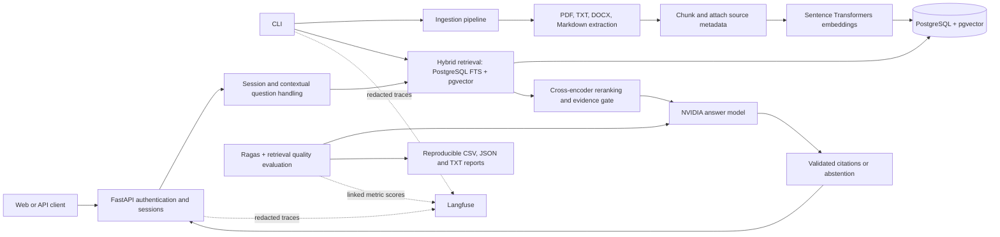

# ContextIQ Architecture

## 1. System Overview

ContextIQ is an enterprise Retrieval-Augmented Generation (RAG) system with hybrid search, strict citation verification, conversation contextualization, observability tracing, and deterministic evaluation gates.

---

## 2. Ingestion Pipeline

The ingestion pipeline handles multi-format document loading, structural extraction, chunking, and vector storage.

### Supported Document Formats
- **PDF**: Processed via `PyPDFLoader` preserving physical 1-based page numbers.
- **TXT**: Plain text loaded directly.
- **Markdown (`.md`, `.markdown`)**: Heading structure (`#` through `######`) is parsed to assign section metadata to subsequent paragraphs.
- **DOCX**: Paragraph styles are inspected to identify Heading styles, grouping text by active section.

### Metadata & Versioning
- Each document receives an immutable SHA-256 hash to detect changes or duplicates.
- Supports document metadata: `title`, `department`, `version`, `effective_date`, `expiry_date`, and `permissions` labels.
- Date validation ensures ISO format (`YYYY-MM-DD`) and guarantees `expiry_date >= effective_date`.
- Document status transitions through `queued`, `processing`, and `completed` or `failed`.
- Document re-indexing swaps chunks and document records in a single database transaction, preserving index availability if an error occurs.

---

## 3. Chunking & Embedding

- **Chunking Engine**: Uses `RecursiveCharacterTextSplitter` configured via `RAG_CHUNK_SIZE` (default: 200 chars) and `RAG_CHUNK_OVERLAP` (default: 40 chars).
- **Embedding Model**: Local `sentence-transformers/all-MiniLM-L6-v2` generating 384-dimensional dense vectors.
- **Processing**: Batch-encoded using PyTorch and normalized for cosine distance.

---

## 4. Vector & Relational Storage

The storage engine runs on **PostgreSQL 16** with the **pgvector** extension:
- `documents`: Primary record of ingested files, hashes, metadata, processing status, and timestamps.
- `document_chunks`: Stores text content, 384-dimensional dense vector (`embedding`), and generated tsvector (`search_vector`).
- **Indexes**:
  - HNSW index on `embedding` with `vector_cosine_ops` for fast similarity search.
  - GIN index on `search_vector` generated with the PostgreSQL `english` text search configuration.
- `app_users`, `conversation_sessions`, `conversation_messages`: Store authentication, chat sessions, and message history with foreign keys and cascade deletions.

---

## 5. Retrieval Pipeline

ContextIQ provides three retrieval modes:

1. **Vector Retrieval**: Computes query cosine distance using pgvector `<=>` operator and converts to similarity score (`1 - cosine_distance`).
2. **Full-Text Search (FTS)**: Uses PostgreSQL `websearch_to_tsquery('english', query)` scored with `ts_rank_cd`.
3. **Hybrid Retrieval (Default)**:
   - Fetches candidate pools (default $3 \times top\_k$) from both vector and FTS retrieval.
   - Combines ranked results using **Reciprocal Rank Fusion (RRF)** with standard constant $k=60$:
     $$RRF(d) = \sum_{m \in \{vector, fts\}} \frac{1}{60 + rank_m(d)}$$
   - Reranks fused candidates with `cross-encoder/ms-marco-MiniLM-L-6-v2`.
   - Fallback: If reranking fails or model is unavailable, gracefully falls back to the RRF rank score.
   - Enriches results with temporal freshness status (`current`, `outdated`, `future`, `superseded`, `undated`).

---

## 6. Evidence Gate & LLM Generation

Before invoking the LLM, the **Evidence Gate** evaluates the retrieved evidence against configurable thresholds:
- `RAG_MIN_VECTOR_SIMILARITY` (default: `0.35`)
- `RAG_MIN_FULL_TEXT_SCORE` (default: `0.02`)
- `RAG_MIN_RERANK_SCORE` (default: `0.0`)
- `RAG_MIN_RRF_SCORE` (default: `0.032`)

If the top retrieved chunk fails the applicable threshold, the pipeline immediately returns an explicit abstention:
> *"I don't have enough evidence in the retrieved documents to answer that question."*

If sufficient evidence is present, the prompt is formatted with structured context items `[S1]`, `[S2]`, etc., and submitted to the **NVIDIA API** (default: `nvidia/nemotron-3-nano-omni-30b-a3b-reasoning`) via `langchain-openai`.

---

## 7. Citation Generation & Verification

- The model is instructed to output JSON with an `answer` containing inline markers like `[S1]` and a `citations` array.
- **Verification Engine**:
  1. Validates that every citation marker corresponds to an actual chunk in the retrieved context.
  2. Ensures citation markers are both declared in the `citations` list and used inline in the text.
  3. Strips unverified or hallucinated citation markers from the generated answer.
  4. If an answer claims facts but cites no valid retrieved source, the pipeline abstains rather than returning unverified assertions.
  5. Enriches valid citations with document ID, filename, page, chunk index, section, version, and temporal freshness.

---

## 8. Authentication & Conversation Sessions

- **API Layer**: Implemented using FastAPI with Pydantic validation schemas.
- **Security**: OAuth2 password bearer tokens signed with HS256 JWT (`JWT_SECRET_KEY`, min 32 chars). Passwords hashed using Argon2 via `pwdlib`.
- **Session Management**: Authenticated users can create, list, and activate chat sessions.
- **Follow-up Contextualizer**: Analyzes up to 12 prior messages in a session. If the user's latest query is ambiguous, it generates a clarification question without running retrieval; otherwise, it rewrites the query into a standalone search query.

---

## 9. Evaluation Pipeline & Quality Gates

The evaluation framework provides comprehensive assessment across deterministic and LLM-assisted metrics:

### 1. Benchmark Dataset
- 100+ evaluation questions categorized into:
  - `factual_retrieval`: Direct factual extraction from policy sections.
  - `conceptual`: High-level principles, missions, and ethical policies.
  - `specific_detail`: Numerical requirements, hours, time windows, and committees.
  - `multi_hop`: Inferences requiring information from multiple sections or pages.
  - `contextual`: Conditional questions and exceptional provisions.
  - `unanswerable`: Out-of-scope questions with `should_abstain: true`.
  - `acl_test`: Questions testing data leakage against forbidden document IDs.

### 2. Retrieval Quality Metrics
- **Precision@K**: Fraction of top-$K$ retrieved items that are relevant.
- **Recall@K**: Fraction of relevant items retrieved in top-$K$.
- **Hit Rate@K**: Binary indicator whether at least one relevant item was retrieved in top-$K$.
- **Mean Reciprocal Rank (MRR)**: Reciprocal rank of the first relevant result.
- **NDCG@K**: Normalized Discounted Cumulative Gain against ideal DCG.

### 3. Citation Quality Metrics
- **Citation Presence**: Checks if citations are included when required.
- **Citation Correctness**: Checks if cited source keys match retrieved chunks.
- **Citation Filename Validity**: Checks if cited filenames exist in retrieved sources.
- **Citation Page Validity**: Checks if cited pages match retrieved sources.
- **Missing Citation Rate**: Flags factual claims produced without citations.

### 4. Abstention Quality Metrics
- **Abstention Quality**: Concordance between expected and actual abstention.
- **Correct Abstention Rate**: Rate of correct abstention on unanswerable questions.
- **False Abstention Rate**: Rate of improper abstention on answerable questions.
- **Unsupported Answer Rate**: Rate of answering questions that should have abstained.

### 5. ACL Leakage Metrics
- Evaluates whether unauthorized documents (marked by `forbidden_document_ids`) are retrieved, cited, or exposed in generated answers.

### 6. Ragas Answer Metrics
- **Faithfulness**: Validates whether the answer is grounded in retrieved context.
- **Answer Relevancy**: Evaluates semantic relevancy to the query.
- **Context Precision & Recall**: Evaluates context ranking against reference answers.
- **Answer Correctness**: Assesses factual agreement with reference answers.

### 7. Evaluation Reports & Quality Gates
- Outputs detailed CSV files, structured JSON summaries, and formatted human-readable TXT reports under `server/evaluation_data/ragas_results/`.
- Enforces configurable thresholds via environment variables (`RAG_EVAL_MIN_RECALL_AT_5`, `RAG_EVAL_MIN_MRR`, `RAG_EVAL_MAX_ACL_LEAKAGE`, etc.).
- `--save-baseline` generates an immutable baseline report; `--enforce-quality-gate` exits with a nonzero code if gates fail.

---

## 10. Observability & Security

- **Langfuse Integration**: Fail-open distributed tracing covering ingestion, chunking, embeddings, retrieval, evidence gating, generation, and API request lifecycles.
- **Centralized Redaction**:
  - Automatically redacts API keys (`sk-`, `nvapi-`, `pk-lf-`), bearer tokens, passwords, database credentials in URLs, and email addresses.
  - Replaces prompt, document, and response text with `[CONTENT REDACTED]` by default.
  - Content telemetry is strictly opt-in via `LANGFUSE_CAPTURE_CONTENT=true`.
  - OpenTelemetry span masking hook scrubs LangChain and Langfuse spans before export.
